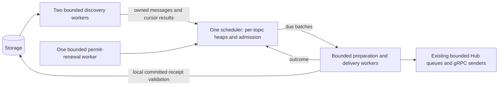

# Bounded full-message scheduler

The dispatcher retains decoded `StoredMessage` data, including the payload.
Storage remains authoritative; restarting discards and rebuilds the queue.
Event keys identify immutable message bytes; delivery receipts track mutable eligibility.
Publish-bound receipts persist destinations with the payload; ownership fencing
and at-least-once retries remain mandatory.

## Ownership and work

Only the scheduler changes heaps, admission counters, cursors, fair rotation,
job markers and the deadline timer. Discovery workers receive copies of cursors,
known keys and result reservations. There is at most one scan and one delivery
job per topic. The two pools are independent, so a slow iterator or proposal on
one topic does not stop another cached deadline. A topic cannot submit duplicate
preparation jobs; known assigned keys are excluded from discovery and checked
again when a result is admitted. Hub reservations remain the authority for
individual recipient attempts after enqueue.

Delivery workers check permission, reuse the immutable cached message,
reread current local committed receipt/ACK state, recheck TTL/exact due time
and enqueue through Hub. Publish-bound messages have no delivery-time storage
commit or per-batch quorum read. Their payload and frozen recipients were
committed together by the publisher. Periodic permit renewal and actual-send
fencing still apply. Background receipt reconciliation releases vanished
universal subscriptions while preserving all named-group obligations.
Actual gRPC Send and pointer-based attempt fencing stay in the existing sender.
One renewal worker reads the metadata and event shards concurrently and requires
both reads to succeed. Renewal starts with at least half the permit remaining;
observed read latency increases this margin without extending the permit.
If permission expires during validation, a publish-bound batch waits in the
scheduler with its bounded reservation and cached payloads. Delivery workers
do not start additional reads. Resuming rechecks the current receipt,
due time, TTL and ownership; actual Send still checks its permit.
Read barriers grant permits from **read start**, as before. The legacy no-argument
ReadBarrier hook captures its installation context: the preparation timeout does
not cancel that hook. The production hook independently bounds reads to two
seconds and uses the application cancellation context. Shutdown waits for it;
custom hooks and storage calls must return before worker shutdown can complete.
No scheduler lock spans storage, quorum or network work.

A single global message heap was rejected because a blocked topic could obstruct
other topics. Per-topic heaps and fair rotation retain current one-job-per-topic
semantics without another ownership partition. By default two discovery workers provide
cross-topic isolation on both engines without overlapping scans of a topic.
`delivery.discoveryWorkers` configures this pool from 1 to 16 workers.
Separate per-topic scanner goroutines or scheduler partitions would add resident
state and require evidence of a scheduler bottleneck first.

## Immutable payload ownership and delivery eligibility

Default `proto.Unmarshal` copies bytes into an independently allocated message.
The vendored protobuf `consumeBytes` uses `append(emptyBuf[:], v...)`; iterator
memory is never retained. Topic strings and unknown fields are also decoded into
owned data. No code mutates a retained message. Hub creates distinct queue-message
pointers per attempt while sharing immutable payload bytes. Serialised values are
released with the iterator, rather than cached alongside decoded messages.

A scheduled message cannot be updated or directly deleted through the API.
An event key identifies the same immutable message bytes throughout its lifetime,
including identical Raft replay and snapshot restoration. Keys must never be reused
for different bytes. Ordered Raft apply enforces this by advancing stale proposed
IDs past its persisted high-water mark, including earlier items/entries in the same
Update. A delayed publish from a former leader becomes a separate message, even
after the earlier message has completed. All replicas make the same allocation
from replicated state; local ID reservations do not authorize overwrites.
The cache therefore retains decoded messages without per-key
versions, hash slots, mutation bitmaps, snapshot tokens or freshness locks. Engine
wrappers can reuse cached payloads without exposing special iterator/read interfaces.
A missing cached message uses an ordinary Get and decode.

Delivery eligibility is separate from payload contents. Preparation checks exact
due time and TTL. The delivery ledger checks payload existence when it creates a
receipt; publish-bound receipts already exist atomically with their payloads.
Final ACK and TTL cleanup atomically remove both the payload and its receipt.
Before enqueue, delivery rereads the current receipt and its ACK bits. Missing or
mismatched receipts do not send, even when discovery or preparation retained an
older payload. A snapshot can restore the same bytes with different receipt/ACK
state; the final receipt read remains authoritative. Adapters without a delivery
ledger retain an ordinary final Get to check existence.

Exact due/TTL checks, current Hub ownership, topic generations and delivery permits
remain mandatory. A completion committed after the final receipt read can race
enqueue, just as a deletion could race the former final payload Get. This is not
atomic delivery versus ACK/expiry. No asynchronous delete notification is needed
for cache safety and no persistent cache version metadata is stored.

## Admission, cursors and retries

Every normal due candidate uses the same admission and heap selection logic,
including when either future-preload setting is zero. The synchronous test adapter
uses those same functions. It is not a second sender algorithm.

A scan reserves result slots before dispatch. Future reservations plus retained
future entries never exceed `preloadMaxMessages`. Due discovery has a separate
allowance of `max(discoveryWorkers, deliveryWorkers) * prepareBatchSize`, so future entries cannot exclude overdue
arrivals. Assigned jobs have the existing `deliveryWorkers * prepareBatchSize`
bound. A heap pop clears its backing slot; sparse heaps/maps rebuild at one-quarter
occupancy, bounding capacity by a constant factor. Topic removal clears its data
and atomically invalidates its generation. Old scan results are admitted only to
the original topic object; old delivery outcomes release only that object's job.
Epoch checks and Hub fencing also cover unsubscribe/re-subscribe and rebalance.

Due and future scans have independent cyclic cursors. The scheduler acknowledges
cursor advancement with the matching generation's result. Byte/size rejection
preserves a resume key; iteration errors/exhaustion wrap to the beginning. Rejected
admission, stale results, keys skipped while assigned and insertions behind a
cursor are recovered by a subsequent cyclic pass. A cursor is never a completion
watermark or proof of cache completeness.

Only results that actually enter admission trigger immediate refill, subject to
reservations and fair rotation. A nonempty scan whose entries are stale,
duplicated or unusable waits for the poll cadence.
Due repair scans keep the poll cadence. Exhausted speculative future scans with
no new candidates back off exponentially up to `delivery.preloadScanIdleMaxInterval`
(default zero disables backoff; the effective limit is at least the poll
interval). A successful commit containing event-key Sets increments one atomic notification
counter per DB and resets this backoff on the next scheduler pass. Metadata-only
commits, deletes, abandoned batches and failed commits do not advance it. This
counter does not validate cached payloads and has no per-key or bitmap metadata.
Engines or wrappers without revision tracking keep the original poll cadence.
A due-only scan does not change the future cursor. Each topic may retain/reserve at most
one due batch, including while its preparation job is busy. The global due
allowance covers at least every preparation worker, so busy topics cannot consume
all admission while another worker is idle. A scan reserves only the unfilled
part of its topic's batch allowance. Future-only scans can still refill within
the independent future allowance; they reserve no shared due credits and do not
advance the due cursor. Topics backing off release remaining ready entries, and
a repair generation prevents older scan results from overwriting that rewind.
A scan already in flight when backoff starts releases its due result rather than
stranding credits; its future entries can still enter the separate cache.
This also preserves admission with more delivery workers than discovery workers.

An individual recipient command that cannot fit the preparation-byte limit is
logged, counted as `delivery_rejected_total{reason="prepare_bytes"}`, and waits
at least one poll interval before rediscovery. Its other due entries also release
shared credits while waiting; future entries retain their separate cache charge.
Full queues, failed proposals and lost permission evict the assigned cache
reference and wait at least one poll interval before retrying. Durable storage
and current Hub readiness then drive recovery;
a send-start ACK-deadline extension cannot be shortened by a cached retry timer.
Unfinished fan-out interests remain independent in persisted receipts. No completed
key history grows without bound.

Commit hints and per-message retry timers are omitted. Cyclic scans run on every
serving replica, recover failed/missed arrivals without callback overflow, and
recheck Hub state for NACK/timeout/full-queue recovery. Productive refill avoids the
fixed polling throughput ceiling. The evaluation reports remaining repeated scan
work; hints may be justified for larger databases or idle-topic populations, but
would add apply-path metadata queues, overflow repair generations and hint-resolution
reads. A key-only hint does not itself save payload I/O. No callbacks are installed
on publish/apply, so failed commits cannot authorize cached arrivals.

The timer selects eligible topic heads, excluding busy topics and respecting retry
eligibility. An earlier admitted deadline rearms it. Expired permission, full
workers and unavailable recipients wait for an event or bounded retry deadline.
Maintenance receipt processing shares bounded discovery/preparation slots with
fair rotation, without adding inactive topics to the delivery heap.

## Count sizing and resource budget

The new default is **512 future messages**, reduced from the metadata-only 4096.
Speculative lookahead defaults to zero (opt-in), because the local many-topic
and immediate cases do not meet the performance acceptance criteria. Existing explicit nonzero counts keep their meaning,
but now retain full messages; operators should size them for actual payloads.
The suggested opt-in trial is 512 at 100 ms, with both zero settings still
supporting due-only delivery. Existing explicitly configured lookaheads are honoured. This is a count limit, **not** a hard byte cap.

On this arm64 build `StoredMessage` is 128 bytes and a candidate is 48 bytes.
Allow roughly 512 bytes per retained message for decoded objects, strings,
heap capacity slack and map bookkeeping. Payload allocation classes matter:
100 KiB rounds up to approximately 104 KiB here. At 512 future messages:

| Payload | Payload only | Estimated future cache including overhead |
| --- | ---: | ---: |
| 1 KiB | 0.5 MiB | 0.75 MiB |
| 64 KiB | 32 MiB | 32.25 MiB |
| 100 KiB | 50 MiB | about 52.25 MiB with allocator rounding |

The default receive limit is 100 KiB for the entire request, so usable payloads
are smaller than that default envelope. It is configurable, and internal storage
can contain larger valid messages. None are truncated or permanently rejected by
a byte cap. These memory figures are estimates, not universal maximums.

Let `C=preloadMaxMessages`, `B=prepareBatchSize`, `W=deliveryWorkers`,
`D=discoveryWorkers`, and `Q` be
a consumer's configured channel capacity. With defaults C=512, B=64, W=2, D=2:

| Stage | Bound | Payload ownership after handoff |
| --- | --- | --- |
| Retained/reserved future entries | C across heaps, scans and result channels combined | Immutable decoded message |
| Due scan results and ready entries | max(D,W)B combined, independent of C; at most B retained/reserved per topic | Same admission representation |
| Assigned preparation/delivery jobs | WB total; one/topic | References removed from heap and held by worker |
| Scanner transients | At most D current decodes plus engine iterators | Released on iterator close/job return |
| Maintenance | At most D discovery jobs and one pending receipt chunk; uses shared pools | One transient payload read/decode per scanner, no retained payload batch |
| Retry state | Per-active-topic deadline and cyclic cursor; no retry payload side queue | Failed jobs evict, then rediscover |
| Heap/map backing capacity | Heap <4 times live entries after drain; maps rebuilt with it | Popped slots zeroed; removed topics clear arrays/maps |
| Sender queues and tracked attempts | Per consumer: Q buffered + at most max(1024,Q) records | Shared immutable payload; expired buffered attempts may outlive tracking |
| Delete/ACK buffers | Existing 8192-key limits per completion kind | Keys/recipient metadata, no payload cache |
| Known-key scan filters | At most D copies of relevant bounded heap/assigned key sets | Keys only |

Conservatively, the heap/discovery/worker stages retain at most `C+max(D,W)B+WB=768`
message allocations plus current decoder transients. At 64 KiB this is about
48 MiB of payload plus bookkeeping, **before** sender queues, in-flight consumers,
storage caches, publish batches and transient fallback reads. Fan-out shares the
same allocation when enqueueing a worker's payload; count shared allocations once.
A later rediscovered retry can allocate another copy while an expired sender queue
still references the old one; the queue bounds above account for that separately.

