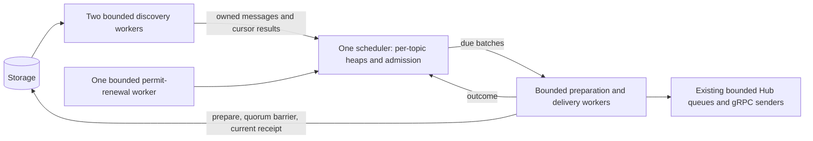

# Bounded full-message scheduler

The dispatcher retains decoded `StoredMessage` data, including the payload.
Storage remains authoritative; restarting discards and rebuilds the queue.
Protocol messages, event keys, Raft commands, WAL/fsync settings, recipient
ownership and at-least-once delivery are unchanged.

## Ownership and work

Only the scheduler changes heaps, admission counters, cursors, fair rotation,
job markers and the deadline timer. Discovery workers receive copies of cursors,
known keys and result reservations. There is at most one scan and one delivery
job per topic. The two pools are independent, so a slow iterator or proposal on
one topic does not stop another cached deadline. A topic cannot submit duplicate
preparation jobs; known assigned keys are excluded from discovery and checked
again when a result is admitted. Hub reservations remain the authority for
individual recipient attempts after enqueue.

Delivery workers check permission before preparation, prepare under the existing
context timeout, perform the post-preparation barrier, validate cached data,
read the current receipt, recheck TTL/exact due time and enqueue through Hub.
Actual gRPC Send and pointer-based attempt fencing stay in the existing sender.
Read barriers grant permits from **read start**, as before. The legacy no-argument
ReadBarrier hook captures its installation context: the preparation timeout does
not cancel that hook. The production hook independently bounds reads to two
seconds and uses the application cancellation context. Shutdown waits for it;
custom hooks and storage calls must return before worker shutdown can complete.
No scheduler/tracker lock spans storage, quorum or network work.

A single global message heap was rejected because a blocked topic could obstruct
other topics. Per-topic heaps and fair rotation retain current one-job-per-topic
semantics without another ownership partition. Two discovery workers provide
cross-topic isolation on both engines without overlapping scans of a topic.
Separate per-topic scanner goroutines or scheduler partitions would add resident
state and require evidence of a scheduler bottleneck first.

## Payload ownership and validity proof

Default `proto.Unmarshal` copies bytes into an independently allocated message.
The vendored protobuf `consumeBytes` uses `append(emptyBuf[:], v...)`; iterator
memory is never retained. Topic strings and unknown fields are also decoded into
owned data. No code mutates a retained message. Hub creates distinct queue-message
pointers per attempt while sharing immutable payload bytes. Serialised values are
released with the iterator, rather than cached alongside decoded messages.

Both built-in engines implement optional `storage.CachedIterator`. A token records
an engine identity, a bounded hash slot of the event key, and the sequence captured
**before** opening the engine snapshot. `storage.payloadCacheSlots` sets the number
of version slots and pending counts per engine (default 4096, power of two from
64 to 1048576). The count is fixed when opening the engine and requires restart
to change; both engines and both standalone/Raft use it. Slot indexes are
`uint32`, and hashing uses a mask because the count is a power of two. Every batch
that touches 24-byte event keys lazily allocates a bitmap sized to that count;
metadata-only batches allocate none.
Before committing any such batch, under a short tracker lock, it advances the
sequence, stamps affected slots and marks them pending. After storage commit
returns (including failure), it advances/stamps again and clears its pending
counts. Tracker locks never cover the commit itself. Multiple overlapping commits
are supported by per-slot counts.

A token validates only when its slot is not pending and its last mutation sequence
is no later than the token's snapshot sequence. Therefore:

1. A mutation after snapshot capture invalidates the token before it changes DB
   contents. A mutation overlapping capture either remains pending at validation
   or has a completion sequence newer than capture. Neither can validate.
2. Both Set and Delete participate, covering normal publish, replay, overwrite,
   explicit deletion, TTL, final ACK deletion and snapshot clear/repopulation.
   Recovery uses the same batch APIs, including its intermediate clear commit.
3. Metadata-only preparation/partial ACK updates do not invalidate payloads.
   Hash collisions invalidate conservatively and require a fresh payload read.
4. Future admission rejects invalidated speculative results. Due admission
   retains uncertain proofs for worker validation: an invalid token can reflect
   a hash collision or pending mutation rather than a changed message. Before
   committing a new receipt, the worker rereads an invalid/unsupported payload
   and checks its current exact due time and TTL. Eligible messages prepare on
   that attempt; deleted, expired or future replacements cannot freeze recipients.
   Final delivery independently validates or rereads after the read barrier.
5. A successful token validation is the payload freshness point corresponding to
   the old final Get. A delete starting afterwards can race enqueue just as it
   could after that Get; the change does not claim atomic delivery versus delete.
   A delete completed before validation cannot be bypassed by cached data.

The final receipt is read again after the barrier. Committed recipient ACK bits
and receipt replacement are authoritative, even if preparation returned an older
manifest. Missing or mismatched receipts do not send. Exact due/TTL checks and
current Hub ownership/permit checks remain mandatory. No async delete notification
is needed for cache safety; correctness lives at the storage mutation boundary.
There is no new wire record or persistent version metadata.

## Admission, cursors and retries

Every normal due candidate uses the same admission and heap selection logic,
including when either future-preload setting is zero. The synchronous test adapter
uses those same functions. It is not a second sender algorithm.

A scan reserves result slots before dispatch. Future reservations plus retained
future entries never exceed `preloadMaxMessages`. Due discovery has a separate
allowance of `max(2, prepareWorkers) * prepareBatchSize`, so future entries cannot exclude overdue
arrivals. Assigned jobs have the existing `prepareWorkers * prepareBatchSize`
bound. A heap pop clears its backing slot; sparse heaps/maps rebuild at one-quarter
occupancy, bounding capacity by a constant factor. Topic removal clears its data
and atomically invalidates its generation. Old scan results are admitted only to
the original topic object; old delivery outcomes release only that object's job.
Epoch checks and Hub fencing also cover unsubscribe/re-subscribe and rebalance.

Due and future scans have independent cyclic cursors. The scheduler acknowledges
cursor advancement with the matching generation's result. Byte/size rejection
preserves a resume key; iteration errors/exhaustion wrap to the beginning. Rejected
admission, stale results, keys skipped while assigned and insertions behind a
cursor are recovered by a subsequent cyclic pass. A cursor is never a completion
watermark or proof of cache completeness.

Only results that actually enter admission trigger immediate refill, subject to
reservations and fair rotation. A nonempty scan whose entries are stale,
duplicated or unusable waits for the poll cadence.
Empty scans wait for the poll cadence. Each topic may retain/reserve at most
one due batch, including while its preparation job is busy. The global due
allowance covers at least every preparation worker, so busy topics cannot consume
all admission while another worker is idle. A scan reserves only the unfilled
part of its topic's batch allowance. Future-only scans can still refill within
the independent future allowance; they reserve no shared due credits and do not
advance the due cursor. Topics backing off release remaining ready entries, and
a repair generation prevents older scan results from overwriting that rewind.
A scan already in flight when backoff starts releases its due result rather than
stranding credits; its future entries can still enter the separate cache.
This also preserves admission with more delivery workers than discovery workers.

An individual recipient command that cannot fit the preparation-byte limit is
logged, counted as `delivery_rejected_total{reason="prepare_bytes"}`, and waits
at least one poll interval before rediscovery. Its other due entries also release
shared credits while waiting; future entries retain their separate cache charge.
Full queues, failed proposals and lost permission evict the assigned cache
reference and wait at least one poll interval before retrying. Durable storage
and current Hub readiness then drive recovery;
a send-start ACK-deadline extension cannot be shortened by a cached retry timer.
Unfinished fan-out interests remain independent in persisted receipts. No completed
key history grows without bound.

Commit hints and per-message retry timers are omitted. Cyclic scans run on every
serving replica, recover failed/missed arrivals without callback overflow, and
recheck Hub state for NACK/timeout/full-queue recovery. Productive refill avoids the
fixed polling throughput ceiling. The evaluation reports remaining repeated scan
work; hints may be justified for larger databases or idle-topic populations, but
would add apply-path metadata queues, overflow repair generations and hint-resolution
reads. A key-only hint does not itself save payload I/O. No callbacks are installed
on publish/apply, so failed commits cannot authorize cached arrivals.

The timer selects eligible topic heads, excluding busy topics and respecting retry
eligibility. An earlier admitted deadline rearms it. Expired permission, full
workers and unavailable recipients wait for an event or bounded retry deadline.
Maintenance receipt processing shares bounded discovery/preparation slots with
fair rotation, without adding inactive topics to the delivery heap.

## Count sizing and resource budget

The new default is **512 future messages**, reduced from the metadata-only 4096.
Speculative lookahead defaults to zero (opt-in), because the local many-topic
and immediate cases do not meet the performance acceptance criteria. Existing explicit nonzero counts keep their meaning,
but now retain full messages; operators should size them for actual payloads.
The suggested opt-in trial is 512 at 100 ms, with both zero settings still
supporting due-only delivery. Existing explicitly configured lookaheads are honoured. This is a count limit, **not** a hard byte cap.

On this arm64 build `StoredMessage` is 128 bytes and a candidate is 72 bytes.
Allow roughly 512 bytes per retained message for decoded objects, strings,
heap capacity slack and map bookkeeping. Payload allocation classes matter:
100 KiB rounds up to approximately 104 KiB here. At 512 future messages:

| Payload | Payload only | Estimated future cache including overhead |
| --- | ---: | ---: |
| 1 KiB | 0.5 MiB | 0.75 MiB |
| 64 KiB | 32 MiB | 32.25 MiB |
| 100 KiB | 50 MiB | about 52.25 MiB with allocator rounding |

The default receive limit is 100 KiB for the entire request, so usable payloads
are smaller than that default envelope. It is configurable, and internal storage
can contain larger valid messages. None are truncated or permanently rejected by
a byte cap. These memory figures are estimates, not universal maximums.

Let `C=preloadMaxMessages`, `B=prepareBatchSize`, `W=prepareWorkers`, and `Q` be
a consumer's configured channel capacity. With defaults C=512, B=64, W=2:

| Stage | Bound | Payload ownership after handoff |
| --- | --- | --- |
| Retained/reserved future entries | C across heaps, scans and result channels combined | Immutable decoded message |
| Due scan results and ready entries | max(2,W)B combined, independent of C; at most B retained/reserved per topic | Same admission representation |
| Assigned preparation/delivery jobs | WB total; one/topic | References removed from heap and held by worker |
| Scanner transients | At most two current decodes plus engine iterators | Released on iterator close/job return |
| Maintenance | At most two discovery jobs and one pending receipt chunk; uses shared pools | One transient payload read/decode per scanner, no retained payload batch |
| Retry state | Per-active-topic deadline and cyclic cursor; no retry payload side queue | Failed jobs evict, then rediscover |
| Heap/map backing capacity | Heap <4 times live entries after drain; maps rebuilt with it | Popped slots zeroed; removed topics clear arrays/maps |
| Sender queues and tracked attempts | Per consumer: Q buffered + at most max(1024,Q) records | Shared immutable payload; expired buffered attempts may outlive tracking |
| Delete/ACK buffers | Existing 8192-key limits per completion kind | Keys/recipient metadata, no payload cache |
| Validity metadata | At `S` configured slots, about `12*S` bytes per engine plus an `S/8`-byte bitmap per batch touching message keys; defaults: 48 KiB and 512 bytes. Small snapshot token. | No per-key unbounded history; commit bitmap traversal grows with `S` |
| Known-key scan filters | At most two copies of relevant bounded heap/assigned key sets | Keys only |

Conservatively, the heap/discovery/worker stages retain at most `C+max(2,W)B+WB=768`
message allocations plus current decoder transients. At 64 KiB this is about
48 MiB of payload plus bookkeeping, **before** sender queues, in-flight consumers,
storage caches, publish batches and transient fallback reads. Fan-out shares the
same allocation when enqueueing a worker's payload; count shared allocations once.
A later rediscovered retry can allocate another copy while an expired sender queue
still references the old one; the queue bounds above account for that separately.

See [evaluation results](heap-scheduler-evaluation.md) for profiles, measured
storage work, variance, rollout tradeoffs and exact validation commands.
